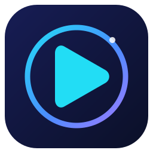
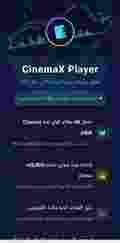

# CinemaX Player

### مشغّل وسائط شامل لأجهزة Android

**فيديو · موسيقى · تلفزيون مباشر · راديو · أدوات وسائط · مركز إسلامي**

  
  
  
  
  

[المميزات](#features) · [صور التطبيق](#screenshots) · [خريطة التطبيق](#app-map) · [البناء](#build) · [الخصوصية](#privacy)

---

## نبذة عن المشروع

**CinemaX Player** تطبيق Android يجمع تشغيل وإدارة الوسائط المحلية ومصادر البث في واجهة واحدة. يضم مكتبة للفيديو والصوت، مشغّلًا مبنيًا على AndroidX Media3، دليلًا للقنوات ومحطات الراديو، أدوات لمعالجة ملفات الوسائط، ومركزًا للقرآن والصلاة والأذكار.

واجهة التطبيق مبنية باستخدام **Kotlin وJetpack Compose وMaterial 3**. تُحفظ بيانات المكتبة والتفضيلات محليًا باستخدام Room وطبقات التخزين في Android، بينما تحتاج خصائص البث والبحث وبعض الخدمات الخارجية إلى اتصال بالإنترنت.

## صور من التطبيق {#screenshots}

اللقطات التالية من واجهة التطبيق الفعلية التي أُرسلت مع تحديث المشروع، وليست صورًا تسويقية أو لقطات قديمة.

| بوابة الدخول والأقسام | مشغّل الفيديو وأدوات التحكم |
|:---:|:---:|
|  |  |

---

## المميزات

### 1. مكتبة الفيديو ومشغّل CinemaX

- فحص ملفات الفيديو المحلية وعرضها ضمن المكتبة والمجلدات.
- عرض شبكي أو قائمة، مع البحث والتصنيف والترتيب.
- تحديد عدة فيديوهات دفعة واحدة، وتحديد الكل، ثم حذفها بعد تأكيد المستخدم.
- تشغيل الملفات المحلية وروابط الوسائط التي يدعمها AndroidX Media3.
- دعم صيغ البث الشائعة HLS وDASH وRTSP عند توافق المصدر والجهاز.
- اختيار مسار الجودة أو الترجمة عندما يوفر المصدر أكثر من مسار.
- التحكم في سرعة التشغيل والتكرار والتنقل داخل المقطع.
- تكرار مقطع بين نقطتي A وB.
- نافذة عائمة Picture-in-Picture، ودعم Google Cast للأجهزة المتوافقة.
- إيماءات للتحكم في السطوع والصوت والتقديم والتأخير والتكبير، مع قفل للمس.

> دعم صيغة بث لا يعني أن كل رابط سيعمل؛ صلاحية الرابط، الترميز، الشبكة، وتوافق الجهاز عوامل مؤثرة.

### 2. مكتبة الموسيقى واستوديو الصوت

- فهرسة الملفات الصوتية المحلية والبحث حسب الاسم والفنان والألبوم والمجلد.
- تشغيل في الخلفية عبر خدمة تشغيل موسيقى مستقلة.
- قوائم تشغيل، تشغيل عشوائي، وأنماط تكرار.
- تحديد عدة ملفات صوتية وحذفها مع تأكيد النظام عند الحاجة.
- معادل صوتي بخمسة نطاقات، وBass Boost وVirtualizer ومؤثرات صوتية بحسب دعم الجهاز.
- قص المقاطع الصوتية وتجهيز نغمة رنين.
- عرض مرئي متحرك للموسيقى أثناء التشغيل.

### 3. التلفزيون المباشر Live TV

- دليل قنوات مصنف حسب مجموعات ومناطق متنوعة داخل كتالوج المشروع.
- إضافة القنوات وإدارة المفضلة.
- تشغيل روابط البث المدعومة باستخدام Media3.
- خدمة لمتابعة حالة البث ومحاولة التعامل مع الانقطاع.
- تنزيل كتالوجات القنوات المتاحة داخل التطبيق.

تعتمد مشاهدة القناة على توفر رابطها وصلاحيته وسياسة مزود البث؛ وجود القناة في الدليل لا يضمن استمرار مصدرها.

### 4. الراديو Radio

- البحث واستعراض محطات الراديو من خلال تكامل Radio Browser.
- تشغيل المحطات في الخلفية.
- إدارة المحطات المفضلة.
- أوضاع للتعامل مع الشبكة واستهلاك البيانات.

عدد المحطات المتاحة يتغير حسب خدمة الدليل ومصادر البث واتصال الإنترنت.

### 5. أدوات الوسائط Media Toolkit

| الأداة | الوظيفة |
|---|---|
| Video Trimmer | تحديد جزء من الفيديو وقصه |
| Video Compressor | ضغط الفيديو وتقليل حجم الملف بالإعدادات المتاحة |
| Audio Extractor | استخراج المسار الصوتي من الفيديو |
| Audio Remover | إزالة المسار الصوتي من ملف فيديو |
| Snapshot Studio | التقاط إطار من الفيديو وحفظه كصورة |
| Video to GIF | تحويل مقطع إلى صورة متحركة GIF |
| Codec Inspector | عرض بيانات الملف مثل الترميز والدقة والمدة ومعدل الإطارات |
| Ringtone Maker | قص جزء صوتي وتجهيزه كنغمة |
| Media Downloader | التحقق من روابط ملفات الوسائط المباشرة وتنزيل المدعوم منها |
| Web Video Sniffer | فتح صفحة ويب والتقاط طلبات ملفات الفيديو المباشرة التي تظهر للمتصفح |
| Duplicate Cleaner | اكتشاف الملفات المتشابهة ومراجعتها قبل الحذف |
| Data Saver Calculator | تقدير استهلاك البيانات وفق إعدادات المشاهدة |
| Local Wi-Fi Share | مشاركة الوسائط عبر خادم محلي على شبكة Wi-Fi |

**حدود التنزيل:** يدعم محرك التنزيل ملفات الوسائط المباشرة التي يسمح الخادم بقراءتها، مثل ملفات MP4 وWebM، مع تمرير بيانات الطلب التي يلتقطها المستكشف عند توفرها. روابط صفحات التواصل ليست ملفات فيديو مباشرة. لا يتجاوز التطبيق DRM أو تسجيل الدخول أو قيود المنصات، ولا يضمن تنزيل كل رابط اجتماعي أو رابط YouTube. قوائم HLS وDASH مدعومة للتشغيل، لكن تجميع أجزاء البث في ملف قابل للتنزيل يحتاج إلى محرك تنزيل بث منفصل.

### 6. المركز الإسلامي

- **القرآن الكريم:** نص محلي بالرسم العثماني، قراءة السور، والرجوع إلى موضع القراءة المحفوظ.
- **مواقيت الصلاة:** حساب وعرض المواقيت والعد التنازلي للصلاة التالية.
- **اتجاه القبلة:** حساب اتجاه القبلة وعرض البوصلة عند توفر الموقع والحساسات.
- **الأذان والتنبيهات:** إعداد تنبيهات الصلاة واختيار الأصوات الموجودة داخل التطبيق.
- **الأذكار والأدعية:** تصنيفات وبحث ومفضلة وخيارات قراءة صوتية.
- **التسبيح والسجل:** عدّاد للتسبيح وسجل للمتابعة.

تحتاج بعض هذه الوظائف إلى إذن الموقع أو اتصال بالإنترنت أو حساسات الجهاز.

### 7. الخزنة المحلية

تتيح شاشة الخزنة الاحتفاظ بملفات مختارة داخل مساحة التطبيق، مع قفل برمز PIN وتشغيل نسخة مؤقتة بعد فك التشفير.

> **تنبيه أمني:** تنفيذ التشفير الحالي في المشروع يستخدم AES/CBC مع IV عشوائي واشتقاق مفتاح مرتبط برمز PIN؛ لم يخضع الكود لتدقيق أمني مستقل. لذلك لا ينبغي اعتباره بديلًا لخزنة احترافية مدققة أو تخزينًا مضمونًا للبيانات شديدة الحساسية.

### 8. النسخ الاحتياطي والمزامنة والمشاركة

- تصدير واستعادة بيانات التطبيق عبر CinemaX Sync Engine.
- يتضمن ملف المزامنة بيانات مثل سجل المشاهدة والتقدم والمفضلة والإشارات المرجعية وبيانات القنوات والراديو وبعض بيانات التنزيل والخزنة.
- إنشاء رمز مزامنة محلي مضغوط باستخدام GZIP وBase64 لإمكان نقله دون اتصال.
- خيار ترحيل سحابي عبر خدمة وسيطة خارجية عند اختيار المستخدم ذلك.
- مشاركة الملفات عبر خادم Wi-Fi محلي من الهاتف إلى جهاز آخر على الشبكة نفسها.

لا تضع بيانات حساسة في خدمات الترحيل الخارجية قبل مراجعة سياسة الخصوصية الخاصة بها.

### 9. التصنيف الذكي

يتضمن المشروع مصنفًا يساعد في تنظيم الفيديوهات اعتمادًا على بيانات الملف مثل الاسم والمجلد والمدة والأبعاد. هذا التصنيف قائم على قواعد ومؤشرات الملف؛ وليس ادعاءً بفهم المحتوى المرئي باستخدام نموذج ذكاء اصطناعي شامل.

---

## خريطة التطبيق {#app-map}

يوضح المخطط الأقسام الرئيسية ومسارات الانتقال بينها.

~~~mermaid
flowchart TD
    A["بوابة CinemaX"] --> B["مشغّل التطبيق"]
    B --> V["الفيديوهات"]
    B --> M["الموسيقى"]
    B --> L["التلفزيون المباشر"]
    B --> R["الراديو"]
    B --> I["المركز الإسلامي"]
    B --> F["المجلدات"]
    B --> T["الأدوات والإعدادات"]

    V --> VP["مشغّل Media3"]
    V --> VD["تحديد وحذف متعدد"]
    M --> MP["مشغّل الموسيقى"]
    M --> MD["تحديد وحذف متعدد"]
    T --> MT["قص وضغط واستخراج وفحص"]
    T --> DL["تنزيل مباشر ومستكشف الويب"]
    T --> SH["مشاركة Wi-Fi ومزامنة"]
    I --> IQ["القرآن والصلاة والقبلة والأذكار"]
~~~

### البنية التقنية

~~~mermaid
flowchart TB
    UI["Jetpack Compose / Material 3"]
    NAV["MainScreen + NavTab + Gateway"]
    UI --> NAV

    NAV --> VIDEO["Video Library / Media3"]
    NAV --> AUDIO["Music / Audio Studio"]
    NAV --> LIVE["Live TV / Radio"]
    NAV --> ISLAMIC["Quran / Prayer / Duas"]
    NAV --> TOOLS["Media Toolkit / Vault / Sync"]

    VIDEO --> MEDIA["MediaScanner + MediaStore"]
    AUDIO --> MEDIA
    LIVE --> NET["Repositories / Network APIs"]
    ISLAMIC --> LOCAL["Assets + Room + Device Services"]
    TOOLS --> LOCAL
    TOOLS --> NET

    LOCAL --> DB["Room / Preferences"]
    VIDEO --> ENGINE["AndroidX Media3"]
    AUDIO --> ENGINE
~~~

### تنظيم المصدر

| المسار | المسؤولية |
|---|---|
| <code>ui/</code> | الشاشات والتنقل ومكونات Compose |
| <code>player/</code> | مشغل الفيديو والإيماءات والجودة والترجمة |
| <code>music/</code> و<code>audio/</code> | تشغيل الموسيقى وخدمات ومؤثرات الصوت |
| <code>media/</code> | فحص الملفات وأدوات المعالجة والتنزيل |
| <code>live/</code> | كتالوج القنوات وتشغيل البث ومتابعة حالته |
| <code>radio/</code> | محطات الراديو وخدمة التشغيل |
| <code>data/</code> | Room وكيانات البيانات وواجهات DAO |
| <code>quran/</code> و<code>duas/</code> و<code>prayer/</code> | القرآن والأدعية ومواقيت الصلاة والأذان |
| <code>security/</code> | الخزنة المحلية |
| <code>sync/</code> و<code>sharing/</code> | النسخ الاحتياطي والمشاركة عبر الشبكة |
| <code>subtitles/</code> | نماذج وخدمات البحث عن الترجمة |

---

## التقنيات وإصدارات المشروع

| التقنية | الإصدار / الإعداد |
|---|---|
| Android minSdk | API 24 |
| Target SDK | API 36 |
| Compile SDK | API 36.1 |
| Kotlin | 2.2.10 |
| Android Gradle Plugin | 9.1.1 |
| Gradle | 9.3.1 |
| Jetpack Compose | Material 3 · BOM 2024.09.00 |
| AndroidX Media3 | 1.5.1 |
| Room | 2.7.0 |
| Coroutines | 1.10.2 |

---

## البناء محليًا {#build}

### المتطلبات

- Android Studio بإصدار يدعم Android Gradle Plugin المستخدم في المشروع.
- JDK 21.
- Android SDK Platform 36.1 وBuild Tools 36.0.0.
- Gradle 9.3.1.

### أوامر البناء والاختبار

لا يحتوي المستودع حاليًا على Gradle Wrapper؛ استخدم Gradle المثبت على جهازك:

~~~bash
gradle :app:testDebugUnitTest
gradle :app:assembleDebug
~~~

بعد نجاح البناء يظهر ملف APK التجريبي في:

~~~text
app/build/outputs/apk/debug/app-debug.apk
~~~

### بناء النسخة التجريبية من GitHub

يبدأ GitHub Actions تلقائيًا عند الدفع إلى <code>main</code>، ويمكن تشغيله يدويًا من صفحة Actions. ينفذ الاختبارات ثم يبني Debug APK ويرفعه كـ Artifact باسم:

<code>CinemaX-Player-Debug-APK</code>

كما يرفع تقارير الاختبارات باسم:

<code>CinemaX-Player-Unit-Test-Reports</code>

[فتح عمليات البناء والتنزيل](https://github.com/ibra8y3-web/CinemaX-Player/actions)

### توقيع نسخة Release

يقرأ إعداد Release متغيرات البيئة التالية:

| المتغير | المعنى |
|---|---|
| <code>KEYSTORE_PATH</code> | مسار ملف keystore |
| <code>STORE_PASSWORD</code> | كلمة مرور keystore |
| <code>KEY_PASSWORD</code> | كلمة مرور المفتاح |
| <code>keyAlias</code> | الاسم الثابت <code>upload</code> في إعداد Gradle الحالي |

لا تضع كلمات المرور أو ملفات التوقيع في المستودع.

---

## الخصوصية والأذونات {#privacy}

- تتم قراءة مكتبة الوسائط المحلية بعد منح أذونات Android المناسبة.
- بعض الخدمات تحتاج إلى الإنترنت، مثل بث القنوات والراديو ومواقيت الصلاة وخدمات الترجمة.
- قد يحتاج اتجاه القبلة ومواقيت الصلاة إلى الموقع أو إعدادات المدينة.
- الإشعارات وخدمات التشغيل في الخلفية والتنبيهات الدقيقة تستخدم أذونات Android المرتبطة بوظائفها.
- مشاركة Wi-Fi تكون على الشبكة المحلية التي يشترك فيها الهاتف والجهاز الآخر.
- لا تشارك رموز المزامنة أو ملفات النسخ الاحتياطي أو بيانات الدخول مع جهات غير موثوقة.

راجع شاشة الأذونات في Android قبل تفعيل أي ميزة تحتاج إلى وصول إضافي.

## المساهمة والإبلاغ عن المشاكل

- افتح Issue يوضح إصدار Android والجهاز وخطوات إعادة المشكلة.
- أرفق سجل الخطأ أو صورة من الشاشة عند الإمكان، مع إخفاء أي بيانات خاصة.
- اجعل التغييرات مركزة، وتأكد من نجاح <code>:app:testDebugUnitTest</code> و<code>:app:assembleDebug</code> قبل إرسال Pull Request.

---

**CinemaX Player — كل وسائطك في تجربة واحدة.**

[المستودع](https://github.com/ibra8y3-web/CinemaX-Player) · [المشكلات والاقتراحات](https://github.com/ibra8y3-web/CinemaX-Player/issues) · [البناء والتنزيل](https://github.com/ibra8y3-web/CinemaX-Player/actions)

