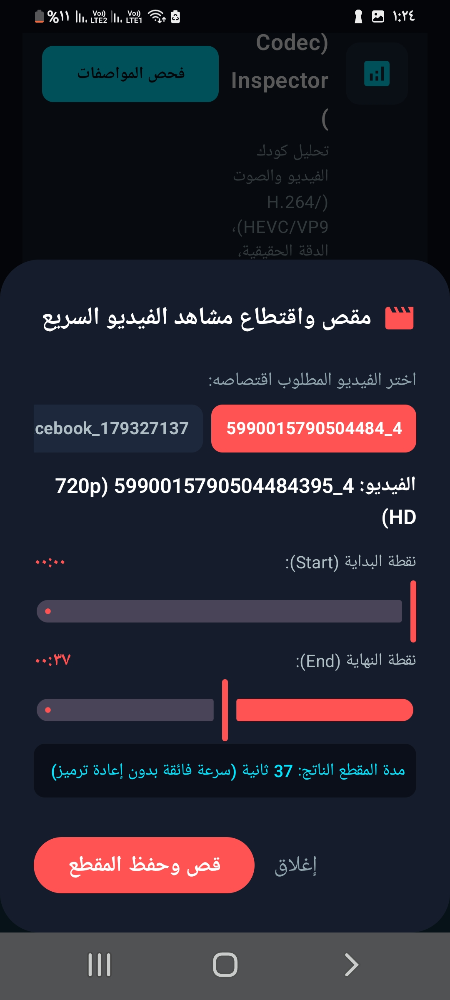
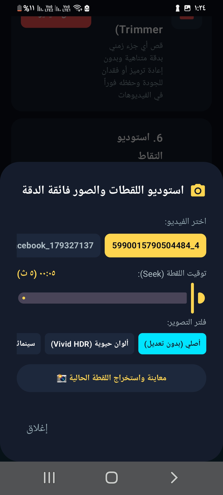

# 🎬 CinemaX Player — مشغل الوسائط والاستوديو السينمائي الشامل

### المشغل الترفيهي والأكثر تكاملاً وقوة لأجهزة أندرويد (Jetpack Compose & AndroidX Media3)

[-3DDC84?style=for-the-badge&logo=android&logoColor=white)](https://developer.android.com)

---

## 🌟 نظرة عامة

**CinemaX Player** هو مشغل وسائط سينمائي متكامل واستوديو مونتاج متطور يعمل محلياً على أندرويد بدون الحاجة إلى خوادم خارجية. صُمم التطبيق بالكامل عبر **Jetpack Compose (Material Design 3)** ومحرك التشغيل العالمي **AndroidX Media3 ExoPlayer** ليجمع في تطبيق واحد: مشغل فيديو 4K/8K، **25 فلتر تحسين ألوان حي**، مشغل موسيقى بمؤثرات بصرية وموازن صوتي خماسي وأداة قص ومشاركة وحذف النغمات، **حزمة أدوات مونتاج ومعالجة وسائط (+14 أداة)**، **تلفزيون مباشر** مع معالجة ذكية لانقطاع البث، **+45,000 محطة راديو عالمية** متوافقة مع باقات السوشيال والميوزك، **موسوعة إسلامية متكاملة**، **خزنة مشفرة بالبصمة**، ومزامنة لا مركزية ذكية عبر الأكواد.

---

## 📸 لقطات حقيقية من داخل التطبيق

| البث المباشر ومشغل الفيديو (HLS / 4K) | مقص ومونتاج الفيديو بدون فقدان جودة | استوديو اللقطات السينمائية (HD Snapshot) |
| :---: | :---: | :---: |
|  |  |  |

| استخراج الصوت النقي من الفيديو | فاحص الكودك والمواصفات التقنية (Codec Inspector) |
| :---: | :---: |
|  |  |

---

## 🚀 أبرز الأقسام والميزات التفصيلية

### 0. بوابة الدخول الاحترافية (CinemaX Welcome Gateway)
* واجهة استقبال سينمائية ترحيبية احترافية بتصميم Material 3 مع عرض بصري لهوية **CinemaX Player** وبطاقات المزايا السريعة وزر انطلاق مباشر نحو مكتبة الوسائط.

---

### 1. مشغل الفيديو السينمائي الخارق (Ultra HD Cinema Player)
* **تشغيل كافة الصيغ والدقات الحقيقية:** دعم 4K و 8K و HDR بمعدل 60FPS وصيغ `MP4, MKV, WebM, TS, M3U8, HLS, DASH, RTSP`.
* **التحكم الكامل بالإيماءات الذكية:**
  * سحب عمودي يميناً للتحكم بالصوت ويساراً للتحكم بسطوع الشاشة.
  * سحب أفقي للتنقل الزمني بدقة عالية، ونقر مزدوج على الحواف للتقديم/التأخير 10 ثوانٍ (`+10s / -10s`).
* **التكبير الحر باللمس (Pinch-to-Zoom 350%):** تكبير مرن بإصبعين حتى `3.5x` مع تحريك المشهد في جميع الاتجاهات وشارة فورية لنسبة التكبير وإعادة الضبط.
* **قفل الأطفال التفاعلي الذكي (Kids Lock & Bubble FX):** يمنع الإيقاف أو الخروج بالخطأ، ويطلق فقاعات ملونة تفاعلية عند لمس الشاشة مع فك قفل آمن بـ 4 نقرات متتالية.
* **مؤقت النوم الذكي مع التلاشي الهادئ (Smart Sleep Fade-Out Timer):** خفض تدريجي ناعم للصوت خلال آخر دقيقتين قبل إيقاف التشغيل تلقائياً.
* **أوضاع التكرار الكاملة للفيديو (Video Repeat Modes):** التبديل بضغطة زر بين: إيقاف التكرار (`OFF`) ⬅️ تكرار المقطع الحالي (`ONE`) ⬅️ تكرار القائمة بالكامل (`ALL`).
* **دعم Picture-in-Picture (PiP) و Google Cast و A-B Repeat وتشغيل الصوت في الخلفية.**
* **حذف مباشر وآمن للفيديوهات (Scoped Storage Delete):** دعم حذف الفيديوهات من بطاقة الفيديو والمجلدات مع نافذة تأكيد وصلاحية النظام الرسمية (`MediaStore.createDeleteRequest`).

---

### 2. استوديو الفلاتر السينمائية الحية (+25 فلتراً احترافياً)
تطبيق فلاتر لونية وبصرية فورية أثناء تشغيل الفيديو أو البث المباشر دون تعديل الملف الأصلي:
1. **Standard** — العرض القياسي الطبيعي.
2. **AMOLED Pure Black** — تعميق الأسود والتباين لتوفير البطارية وإبراز الشاشات الحديثة.
3. **Cinema Warm** — طابع أفلام هوليوود الدافئ.
4. **Night Eye Comfort Shield** — تصفية الضوء الأزرق لراحة العين ليلاً.
5. **AI Vivid Super-Clarity** — تعزيز الوضوح والحدة وتفاصيل المشاهد.
6. **Cinematic Noir B&W** — أبيض وأسود درامي كلاسيكي.
7. **Cyberpunk Neon** — تباين نيوني مستقبلي جريء.
8. **Vintage Film Sepia** — طابع السبعينيات الدافئ الكلاسيكي.
9. **Cold Sci-Fi Space** — إضاءة زرقاء باردة لأفلام الخيال العلمي.
10. **Emerald Vibrant Nature** — إشباع زمردي مخصص لمشاهد الطبيعة.
11. **Sunset Golden Glow** — وهج الغروب الذهبي الدافئ.
12. **Matte Cinema** — تباين سينمائي مطفي هادئ.
13. **Deep Ocean Blues** — درجات أزرق سينمائية عميقة.
14. **Rose Gold Elegance** — لمسة روز جولد ناعمة وأنيقة.
15. **Matrix Digital Green** — فلتر رقمي أخضر سينمائي.
16. **Autumn Warmth** — درجات خريفية برتقالية دافئة.
17. **Arctic Frost** — بياض قطبي بارد ناصع.
18. **Chocolate Warm** — تدرجات دافئة كلاسيكية غنية.
19. **Neon Purple Glow** — توهج أرجواني ساطع.
20. **Vintage 8mm Film** — محاكاة شريط أفلام 8 مم الكلاسيكي.
21. **HDR Ultra Boost** — رفع النطاق الديناميكي والتفاصيل.
22. **Teal & Orange Hollywood** — التدرج الهوليوودي الأشهر للأكشن والسينما.
23. **Cyan Dream** — طابع سيان سماوي ناعم.
24. **Moonlight Silver** — إضاءة فضية ليلية هادئة.
25. **Cinematic Blood Red** — أحمر درامي داكن للمشاهد الحماسية.

---

### 3. مشغل الموسيقى واستوديو الصوتيات والمؤثرات التفاعلية (Dynamic Music Studio)
* **إدارة متكاملة للمقاطع الصوتية:**
  * **قص نغمات الرنين (Ringtone & Waveform Cutter):** اقتطاع دقيق بالموجة الصوتية التفاعلية مع **تأثير التلاشي التدريجي (Fade In / Fade Out)** والحفظ وتعيين الملف كنغمة رنين أو إشعارات.
  * **مشاركة فورية للأغاني والمقاطع الصوتية** عبر تطبيقات المراسلة والنظام.
  * **حذف حقيقي للصوتيات من الذاكرة** متوافق تماماً مع `Android 10+ Scoped Storage`.
* **أدوات التكرار والعشوائية الاحترافية:**
  * **تشغيل عشوائي (Shuffle)** و **أوضاع التكرار الكاملة (`OFF` / `ALL` / `ONE`)** مع أزرار مدمجة ومتجاوبة أعلى/أسفل شريط المشغل المصغر.
* **المؤثرات البصرية الحركية (6 أنماط Dynamic Visualizer):**
  1. `Spectrum Bars` (أعمدة الطيف التفاعلية)
  2. `Vinyl Pulse` (نبض أسطوانة الفينيل الدوارة)
  3. `Neon Wave` (الموجات النيونية المتدفقة)
  4. `Aurora Orb` (هالة الأورورا الكونية)
  5. `Retro Equalizer` (المعادل الكلاسيكي)
  6. `Cyber Matrix` (المصفوفة الرقمية)
* **استوديو الموازن الصوتى الخماسي (5-Band Equalizer Studio):**
  * التحكم بترددات الصوت، **Bass Boost**، المحيطي **3D Virtualizer**، ورفع الجهير والصوت **Loudness Enhancer** حتى `200%` مع قوالب مسبقة الضبط (`Rock, Pop, Jazz, Classical, Hip Hop, Heavy Metal`).

---

### 4. حزمة الأدوات الهندسية والمونتاج السريع (14+ أداة حقيقية بدون إنترنت)
1. **محول الفيديو إلى GIF فائق السرعة (Fast Video to GIF Maker):** تحويل ثوانٍ مختارة إلى GIF عالية الجودة بمعدل إطارات قابل للتخصيص وحفظها في `Pictures/CinemaX_GIFs` مع مشاركة مباشرة لواتساب وتليجرام.
2. **استوديو قص الصوتيات وصنع نغمات الرنين (Waveform Cutter & Ringtone Maker):** قص دقيق مع `Fade In / Fade Out` وحفظ مباشر في `Ringtones/CinemaX_Ringtones`.
3. **ضاغط الفيديوهات وموفر المساحة (Smart Offline Video Compressor):** تقليص حجم الفيديو بنسبة `30% / 50% / 70%` مع عرض المساحة الموفرة وحفظها في `Movies/CinemaX_Compressed`.
4. **استوديو كتم وحذف الصوت من الفيديو (Lossless Audio Remover):** إزالة المسار الصوتي بدون إعادة ترميز الفيديو في `Movies/CinemaX_Silent`.
5. **مقص واقتطاع مشاهد الفيديو السريع (Lossless Video Trimmer):** قص أي جزء من الفيديو بسرعة فائقة دون فقدان جودة.
6. **استوديو التقاط اللقطات فائقة الدقة (HD Snapshot Studio):** استخراج صور من الفيديو مع فلاتر وتصديرها مباشرة للمعرض.
7. **فاحص الكودك والمواصفات التقنية (Codec Inspector):** استعراض الكودك (`H.264 / HEVC / VP9 / AV1`)، الدقة الحقيقية، البت ريت، وعدد الإطارات.
8. **حاسبة باقة الإنترنت وفاحص سرعة السيرفر (Bandwidth & Ping Advisor).**
9. **أداة التحميل الذكي والتحقق من الروابط (Anti-400 Video Downloader):** التحقق المسبق من الروابط وتجاوز أخطاء الخادم (`400 / 403`) مع استئناف التنزيل.
10. **المستكشف الذكي لالتقاط فيديوهات الويب (Web Video Sniffer):** متصفح ذكي يلتقط روابط الفيديو المباشرة (`MP4, M3U8, CDN`) أثناء التشغيل من منصات التواصل.
11. **خادم المشاركة المحلي بدون إنترنت (Local Wi-Fi File Share Server):** نقل ومشاركة الملفات عبر المتصفح على الشبكة المحلية.
12. **المزامنة السحابية الذكية واللامركزية (CinemaX Code & Backup Sync):** إنشاء كود مزامنة واستيراده على أي هاتف آخر لاسترجاع المفضلة والسجل والعلامات المرجعية فوراً.
13. **استوديو الفيديو الإعلاني والترويجي (CinemaX Promo Studio):** تصوير وتوليد فيديو ترويجي حقيقي (`9:16` للريلز أو `16:9` لليوتيوب) بترميز عتادي `H.264 MediaCodec`.
14. **مكتشف ومنظف الوسائط والملفات المكررة (Duplicate Media Cleaner):** فحص حقيقي لملفات الفيديو والصوت المتطابقة بالبصمة التقنية `(الحجم الدقيق + المدة الزمنية)` مع الحفاظ على نسخة أصلية وحذف النسخ المكررة بنقرة واحدة لتحرير جيجابايتات من المساحة.

---

### 5. التلفزيون المباشر والراديو العالمي والموسوعة الإسلامية
* **دليل البث المباشر (+1,050 قناة تلفزيونية وإسلامية مفحوصة 100%):** تصنيف حسب الدول والأنواع والمفضلة، إمكانية إضافة وحذف أي قناة بمرونة، شريط بحث وأدوات علوية متجاوبة مع الشاشات الصغيرة، وفاحص روابط حقيقي مع مصادر احتياطية (`Auto-Failover`) عند تقطع البث.
* **+45,000 محطة راديو عالمية حقيقية:** بحث فوري، تصنيف حسب الدول والمحتوى، **أوضاع توفير بيانات ذكية متوافقة مع باقات الموبايل (نت عام، باقة سوشيال، باقة ميوزك، باقة فيديو)**، ومشغل مصغر عائم.
* **الموسوعة الإسلامية المتكاملة:**
  * **القرآن الكريم كاملاً** مع حفظ آخر موضع قراءة.
  * **مواقيت الصلاة الدقيقة والأذان** حسب الموقع الفلكي.
  * **بوصلة القبلة الدقيقة** المعتمدة على مستشعرات الهاتف.
  * **مئات الأدعية والأذكار وحصن المسلم** بالصوت والنص.

---

### 6. الخزنة السرية المشفرة (Encrypted AES Vault)
* تشفير ونقل الملفات الخاصة داخل مساحة معزولة محمية بكلمة مرور PIN وبصمة الإصبع (`Biometric Authentication`).

---

## ⚙️ البناء التلقائي عبر GitHub Actions (CI/CD)

تم تجهيز المشروع بملف بناء آلي متكامل في `.github/workflows/android-build.yml` يقوم تلقائياً عند كل `Push` أو `Pull Request` أو تشغيل يدوي (`workflow_dispatch`) بالآتي:
1. إعداد **JDK 21 (Temurin)** و **Android SDK** و **Gradle 9.3.1**.
2. تهيئة مفتاح التوقيع التجريبي (`debug.keystore`) تلقائياً لبيئة السيرفر.
3. تشغيل جميع اختبارات الوحدة و Robolectric (`:app:testDebugUnitTest`).
4. بناء ملف التطبيق بصيغة APK (`:app:assembleDebug`).
5. رفع ملف `CinemaX-Player-Debug-APK` وتقارير الاختبار كـ **GitHub Artifacts** جاهزة للتحميل مباشرة من تبويب **Actions**.

---

## 🛠️ البنية التقنية والهندسية (Tech Stack)

| المكون | التقنية المستخدمة |
| :--- | :--- |
| **لغة البرمجة** | Kotlin `2.2.10` |
| **واجهة المستخدم** | Jetpack Compose + Material Design 3 |
| **محرك التشغيل** | AndroidX Media3 ExoPlayer `1.5.1` (HLS / DASH / RTSP / Cast) |
| **معالجة الميديا والمونتاج** | `MediaExtractor`, `MediaMuxer`, `MediaCodec`, `MediaMetadataRetriever` |
| **قاعدة البيانات المحلية** | Room Database `2.7.0` + KSP |
| **تحميل الصور المصغرة** | Coil `2.7.0` & Local MediaStore Thumbnails |
| **الشبكات والبيانات** | Retrofit `2.12.0` + OkHttp + Moshi `1.15.2` |
| **الأتمتة والاختبارات** | JUnit 4 + Robolectric `4.16.1` + Coroutines Test + GitHub Actions |
| **أدوات البناء والتوافق** | AGP `9.1.1` • Gradle `9.3.1` • Android 7.0 (`minSdk 24`) إلى Android 16 (`targetSdk 36`) |

---

## 🛡️ سياسة الأمان والخصوصية
* **تنفيذ حقيقي 100%:** جميع الأدوات والتشغيل والحذف والتشفير وفحص التكرار تعمل على ملفات النظام الفعلية عبر واجهات أندرويد الرسمية (`MediaStore`, `ContentResolver`, `MediaCodec`) دون أي بيانات وهمية.
* **العمل بدون إنترنت (Offline First):** كافة أدوات المونتاج (القص، الضغط، تحويل GIF، كتم الصوت، استخراج الصوت، تنظيف التكرارات، الفلاتر، والخزنة) تعمل محلياً على جهازك دون رفع ملفاتك لأي خادم خارجي.
* **الالتزام بسياسات Scoped Storage & Google Play:** استخدام الأذونات اللازمة فقط ومعالجات الحذف الرسمية المعتمدة من أندرويد 10 فما فوق.
