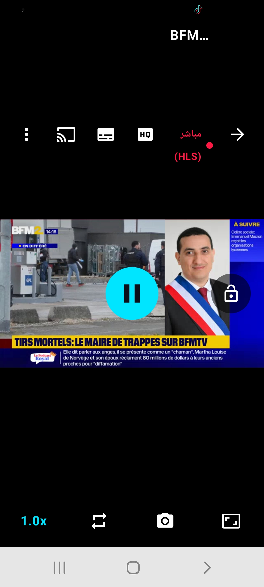
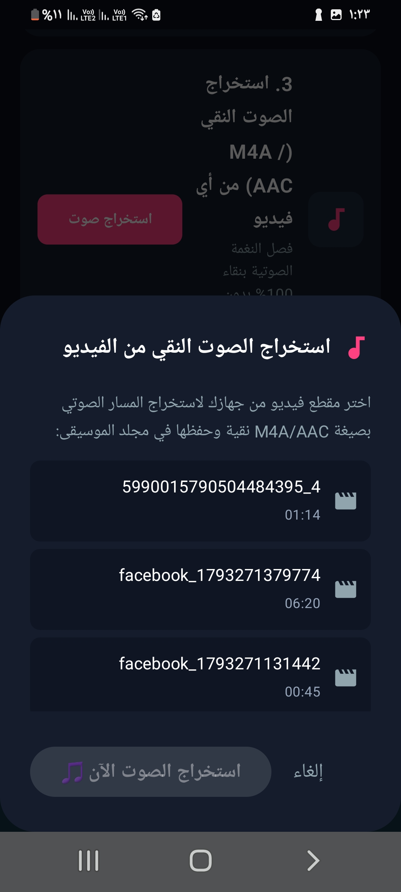
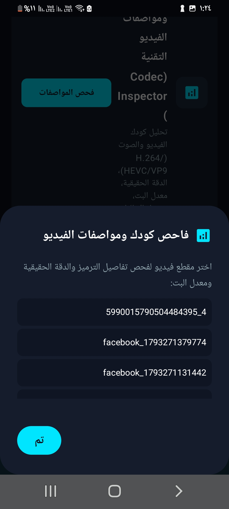
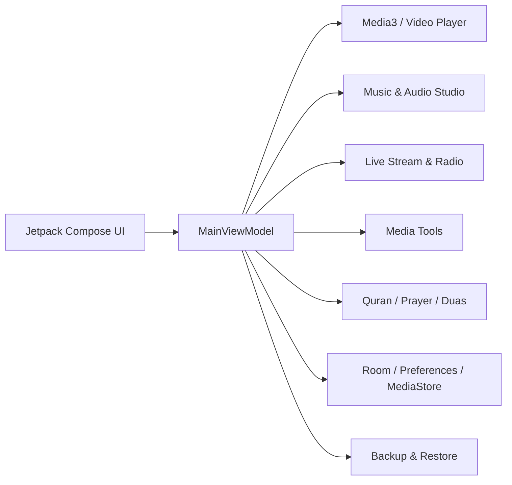

```mermaid
flowchart TB
    A["CinemaX Player"] --> B["مكتبة الوسائط"]
    A --> C["المشاهدة والبث"]
    A --> D["الصوتيات"]
    A --> E["الأدوات"]
    A --> F["المركز الإسلامي"]
    A --> G["الخصوصية والبيانات"]

    B --> B1["الفيديوهات"]
    B --> B2["المجلدات والتصنيف"]

    C --> C1["مشغّل Media3"]
    C --> C2["Live TV"]
    C --> C3["الترجمة و Cast و PiP"]

    D --> D1["مشغّل الموسيقى"]
    D --> D2["المعادل والمؤثرات"]
    D --> D3["قص النغمات"]

    E --> E1["قص وضغط وتحويل GIF"]
    E --> E2["استخراج الصوت واللقطات"]
    E --> E3["الفحص والتنزيل والمشاركة"]
    E --> E4["تنظيف الملفات المكررة"]

    F --> F1["القرآن والأدعية"]
    F --> F2["الصلاة والقبلة والأذان"]
    F --> F3["التسبيح والسجل"]

    G --> G1["الخزنة المحلية"]
    G --> G2["النسخ الاحتياطي والاستعادة"]
```

<div align="center">


# CinemaX Player

### مشغّل وسائط شامل وتجربة سينمائية متكاملة على Android

مشاهدة الفيديو، تشغيل الموسيقى، البث المباشر والراديو، أدوات معالجة الوسائط، ومركز إسلامي — في تطبيق واحد مبني باستخدام **Kotlin** و **Jetpack Compose** و **AndroidX Media3**.

<p>
  <a href="https://github.com/ibra8y3-web/CinemaX-Player/actions/workflows/android-build.yml"></a>
  
  
  
  
</p>

<p>
  <a href="https://github.com/ibra8y3-web/CinemaX-Player/actions">البناء والتنزيل</a> ·
  <a href="#screenshots">صور التطبيق</a> ·
  <a href="#features">المميزات</a> ·
  <a href="#build">طريقة البناء</a>
</p>


</div>

---

## <a id="overview"></a> نظرة عامة

**CinemaX Player** هو تطبيق Android لإدارة وتشغيل الوسائط، يجمع بين مكتبة الفيديو والصوت ومشغّل Media3، البث التلفزيوني والراديو، وأدوات عملية للتعامل مع ملفات الوسائط المحلية.

التطبيق مبني بواجهة **Jetpack Compose / Material 3**، ويستخدم **Room** لحفظ البيانات المحلية، وواجهات Android القياسية للوصول إلى الملفات ومعالجتها. بعض الخدمات — مثل البث المباشر، محطات الراديو، الترجمة عبر الإنترنت ومواقيت الصلاة — تحتاج إلى اتصال بالإنترنت.

### معلومات المشروع

| البند | التفاصيل |
|---|---|
| المنصة | Android |
| الحد الأدنى | Android 7.0 — API 24 |
| Target SDK | API 36 |
| Compile SDK | API 36.1 |
| اللغة | Kotlin 2.2.10 |
| الواجهة | Jetpack Compose + Material 3 |
| مشغّل الوسائط | AndroidX Media3 1.5.1 |
| قاعدة البيانات | Room 2.7.0 |
| نظام البناء | Android Gradle Plugin 9.1.1 · Gradle 9.3.1 |

---

## <a id="screenshots"></a> صور من داخل التطبيق

الصور التالية من مجلد لقطات المشروع، ويمكن استبدالها أو إضافة لقطات أحدث إلى <code>docs/screenshots/</code> عند تحديث الواجهات.

<div align="center">

| مشغّل الفيديو والبث المباشر | قص وتحرير الفيديو |
|:---:|:---:|
|  |  |

| استوديو التقاط الصور | استخراج الصوت |
|:---:|:---:|
|  |  |

| فاحص معلومات الوسائط |
|:---:|
|  |

</div>

---

## <a id="features"></a> المميزات والأقسام

### 1. مكتبة الفيديو ومشغّل CinemaX

- فهرسة ملفات الفيديو المحلية وعرضها ضمن المكتبة والمجلدات.
- تشغيل الملفات المحلية وروابط البث المدعومة بواسطة Media3.
- دعم مصادر البث الشائعة مثل **HLS و DASH و RTSP** بحسب توافق الرابط والجهاز.
- التحكم بسرعة التشغيل، التكرار، والتنقل داخل المقطع.
- التكرار بين نقطتين **A–B Repeat**.
- اختيار جودة/مسار الفيديو عند توفر مسارات متعددة.
- دعم الترجمة ومسارات الترجمة الخارجية.
- وضع **Picture-in-Picture (PiP)** للتحكم أثناء استخدام تطبيقات أخرى.
- دعم **Google Cast** للأجهزة المتوافقة.
- إيماءات للتحكم أثناء المشاهدة، وقفل شاشة المشغّل.

### 2. مشغّل الموسيقى واستوديو الصوت

- مكتبة صوتيات محلية وتشغيل في الخلفية.
- قوائم تشغيل، تشغيل عشوائي، وأنماط التكرار.
- معادل صوتي بخمسة نطاقات.
- Bass Boost ومؤثر Virtualizer للصوت المحيطي.
- إعدادات صوت مسبقة وتأثيرات لتحسين تجربة الاستماع.
- قص المقاطع الصوتية وإنشاء نغمات رنين مع تحديد الجزء المطلوب.

### 3. التلفزيون المباشر Live TV

- دليل قنوات مصنّف حسب القوائم المتاحة داخل المشروع.
- إضافة القنوات المخصصة وإدارة المفضلة.
- تشغيل روابط البث عبر Media3.
- خدمة لمتابعة حالة البث والتعامل مع انقطاع الاتصال ومحاولات الاستعادة.
- تعتمد مشاهدة القناة على صلاحية رابط البث وتوفر مصدره.

### 4. الراديو Radio

- استعراض محطات الراديو والبحث عنها.
- تشغيل المحطات في الخلفية عبر خدمة تشغيل مستقلة.
- تصنيف المحطات وإدارة المحطات المفضلة.
- أوضاع للشبكة/الباقات لتكييف طلبات الاتصال مع مصادر المحطات.
- توفر المحطات وجودة البث يعتمدان على مزود الخدمة والاتصال.

### 5. أدوات الوسائط Media Toolkit

تضم شاشة الأدوات مجموعة من الوظائف، من بينها:

| الأداة | الاستخدام |
|---|---|
| Video Trimmer | تحديد جزء من الفيديو واقتطاعه |
| Video Compressor | تقليل حجم ملف الفيديو بإعدادات الضغط المتاحة |
| Audio Extractor | استخراج المسار الصوتي من الفيديو |
| Audio Remover | إزالة المسار الصوتي من ملف فيديو |
| Snapshot Studio | التقاط إطار من الفيديو وحفظه كصورة |
| Video to GIF | تحويل مقطع محدد إلى GIF |
| Codec Inspector | قراءة معلومات الفيديو والصوت مثل الدقة والترميز والمدة ومعدل الإطارات |
| Ringtone Maker | قص مقطع صوتي وتجهيزه كنغمة |
| Media Downloader | التحقق من روابط الوسائط وتنزيل الملفات المباشرة المدعومة |
| Web Video Sniffer | مراقبة طلبات صفحة الويب لاكتشاف روابط الوسائط |
| Duplicate Cleaner | اكتشاف ملفات الوسائط المتكررة ومراجعتها قبل الحذف |
| Data Saver & Ping | تقدير استهلاك البيانات واختبار استجابة رابط/خادم |
| Local Wi-Fi Share | تشغيل خادم مشاركة محلي للوصول إلى الفيديوهات عبر الشبكة المحلية |

> ملاحظة: نجاح التنزيل أو تشغيل البث يعتمد على نوع الرابط، وسياسات الموقع المصدر، وتوفر الاتصال. لا يعني وجود أداة اكتشاف الروابط أن كل منصة خارجية تسمح بالتنزيل.

### 6. المركز الإسلامي

- **القرآن الكريم:** نص محلي بالرسم العثماني، قائمة السور، البحث، وحفظ موضع القراءة.
- **مواقيت الصلاة:** عرض المواقيت والعد التنازلي للصلاة التالية.
- **اتجاه القبلة:** حساب الاتجاه وعرض البوصلة عند توفر الموقع وحساسات الجهاز.
- **الأذان والتنبيهات:** اختيار أصوات الأذان وإعداد التنبيهات.
- **الأذكار والأدعية:** تصنيفات، بحث، مفضلة، عدّاد متابعة، وخيارات القراءة الصوتية.
- **التسبيح والسجل:** أدوات للعدّ ومتابعة السجل.

تحتاج ميزات الموقع إلى منح إذن الموقع، وقد تختلف دقة الاتجاه حسب معايرة بوصلة الهاتف وتوفر الحساسات.

### 7. الخزنة المحلية

- مساحة داخلية لحفظ ملفات مختارة بعيدًا عن قائمة الوسائط العامة.
- حماية الوصول باستخدام PIN.
- تشفير الملفات داخل مساحة التطبيق المحلية.

### 8. النسخ الاحتياطي والمزامنة

- إنشاء بيانات تصدير/نسخ احتياطي عبر محرك CinemaX Sync.
- تضمين عناصر مثل سجل التشغيل والمفضلة والعلامات المرجعية وبعض إعدادات التطبيق والقوائم المدعومة.
- استيراد النسخة واختيار طريقة الاستعادة المتاحة، مثل الدمج أو الاستبدال.

### 9. التصنيف الذكي للوسائط

يتضمن المشروع أداة لتصنيف مقاطع الفيديو اعتمادًا على بيانات مثل الاسم والمجلد والمدة واتجاه الفيديو، مع فئات مقترحة مثل الأفلام، التلاوات، المقاطع القصيرة، اللقاءات والشروحات. التصنيف مساعد لتنظيم المكتبة وليس نموذج تعرّف مضمونًا على محتوى كل فيديو.

---

## <a id="feature-map"></a> خريطة أقسام التطبيق



---

## <a id="architecture"></a> البنية التقنية



### تنظيم المصدر

| المسار | المسؤولية |
|---|---|
| <code>app/src/main/java/com/example/ui/</code> | الشاشات والتنقل ومكونات الواجهة |
| <code>player/</code> | مشغّل الفيديو والتحكم والجودة |
| <code>music/</code> و <code>audio/</code> | تشغيل الصوتيات والمؤثرات |
| <code>live/</code> | القنوات والبث المباشر |
| <code>radio/</code> | المحطات وتشغيل الراديو |
| <code>media/</code> | أدوات معالجة وتنزيل وفحص الوسائط |
| <code>data/</code> | قاعدة البيانات والنماذج والتفضيلات |
| <code>quran/</code> و <code>prayer/</code> و <code>duas/</code> | الوظائف الإسلامية |
| <code>security/</code> | إدارة الخزنة المحلية |
| <code>sharing/</code> و <code>sync/</code> | المشاركة المحلية والنسخ الاحتياطي |
| <code>app/src/main/res/</code> | موارد Android، ومنها أيقونة التطبيق |

---

## <a id="build"></a> بناء المشروع

### المتطلبات

- Android Studio بإصدار يدعم Android Gradle Plugin المستخدم في المشروع.
- JDK 21.
- Android SDK Platform 36.1.
- Android Build Tools 36.0.0.
- Gradle 9.3.1.

### البناء من Android Studio

1. افتح المستودع في Android Studio.
2. انتظر اكتمال Gradle Sync وتنزيل الاعتماديات.
3. اختر إعداد البناء **debug**.
4. شغّل مهمة <code>assembleDebug</code> من نافذة Gradle أو من الطرفية.

### البناء من الطرفية

بعد تثبيت Gradle 9.3.1 وضبط Android SDK:

```bash
gradle --version
gradle :app:testDebugUnitTest
gradle :app:assembleDebug
```

المسار المتوقع لملف APK بعد نجاح المهمة:

```text
app/build/outputs/apk/debug/app-debug.apk
```

### التوقيع لإصدار Release

إعداد Release يستخدم ملف keystore خارجيًا. قبل بناء نسخة Release، جهّز ملف التوقيع واضبط المتغيرات التالية في بيئة البناء أو GitHub Actions Secrets:

- <code>KEYSTORE_PATH</code>
- <code>STORE_PASSWORD</code>
- <code>KEY_PASSWORD</code>

اسم المفتاح المستخدم في إعداد المشروع هو <code>upload</code>. لا ترفع ملف keystore أو كلمات المرور إلى المستودع.

---

## <a id="ci"></a> البناء التلقائي عبر GitHub Actions

ملف سير العمل:

<code>.github/workflows/android-build.yml</code>

يعمل عند الدفع إلى فرعي <code>main</code> أو <code>master</code>، وعند فتح Pull Request، ويمكن تشغيله يدويًا من تبويب Actions.

خطواته الأساسية:

1. تنزيل ملفات المستودع.
2. إعداد JDK 21 وAndroid SDK.
3. تثبيت منصة Android المطلوبة وأدوات البناء.
4. إعداد Gradle.
5. تشغيل اختبارات الوحدة وRobolectric.
6. بناء Debug APK.
7. رفع ملف APK وتقارير الاختبار كـArtifacts عند توفرها.

**تنزيل APK:** افتح [GitHub Actions](https://github.com/ibra8y3-web/CinemaX-Player/actions)، واختر آخر تشغيل ناجح، ثم حمّل Artifact باسم <code>CinemaX-Player-Debug-APK</code>.

---

## <a id="permissions"></a> الأذونات والاتصال

يستخدم التطبيق الأذونات بحسب الوظيفة المطلوبة:

- أذونات قراءة الفيديو والصوت لعرض مكتبة الوسائط.
- الإنترنت وحالة الشبكة للبث والراديو والخدمات المتصلة.
- الموقع لمواقيت الصلاة واتجاه القبلة عند تفعيل هذه الوظائف.
- الإشعارات والخدمات الأمامية لتشغيل الوسائط والتنبيهات في الخلفية.
- أذونات النظام اللازمة لعمليات الحذف أو المشاركة التي تتطلب موافقة المستخدم.

لا تمنح إذنًا إلا عند الحاجة إلى الميزة المرتبطة به. وقد تتطلب بعض الخدمات الخارجية اتصالًا نشطًا أو رابطًا صالحًا.

---

## <a id="privacy"></a> الخصوصية وملاحظات الاستخدام

- تتم عمليات كثيرة على الملفات المحلية باستخدام واجهات Android مثل MediaStore وMediaExtractor وMediaMetadataRetriever.
- البث المباشر والراديو وبعض خدمات الترجمة ومواقيت الصلاة تعتمد على الإنترنت ومصادر خارجية.
- مشاركة Wi-Fi المحلية تتطلب أن يكون الهاتف والجهاز المستقبِل على الشبكة المحلية نفسها.
- توفر القنوات والمحطات والروابط الخارجية ليس مضمونًا؛ فقد تتغير المصادر أو تتوقف.
- الخزنة ميزة محلية داخل التطبيق، ولا ينبغي اعتبارها بديلًا عن حل تخزين أمني خضع لتدقيق مستقل.

---

## المساهمة والتطوير

للمساعدة في التطوير أو الإبلاغ عن مشكلة:

1. افتح Issue يوضح المشكلة وخطوات إعادة إنتاجها.
2. أرفق سجل الخطأ أو لقطة شاشة عند الحاجة، مع إزالة أي بيانات شخصية أو مفاتيح سرية.
3. استخدم Pull Request للتغييرات المقترحة مع توضيح الملفات المتأثرة وطريقة الاختبار.

<div align="center">

**CinemaX Player**  
مشاهدة أذكى، أدوات أكثر، وتجربة وسائط في مكان واحد.

[المستودع](https://github.com/ibra8y3-web/CinemaX-Player) · [المشكلات والاقتراحات](https://github.com/ibra8y3-web/CinemaX-Player/issues) · [البناء والتنزيل](https://github.com/ibra8y3-web/CinemaX-Player/actions)

</div>
